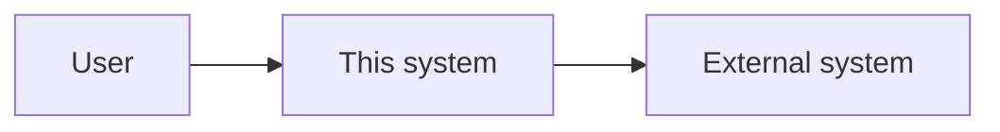

# Architecture

## Style and why
Advisor output (traits: LegacySystems, SeveralBusinessAreas, ExternalPartnerIntegrations, SmallTeam):

### Recommendation: ModularMonolith

Several business areas need clear boundaries, but one deployment and one database keep it cheap to run and easy to hand over.

#### Patterns
- **AdapterPerPartner**: Each outside system gets its own adapter behind an interface, so its quirks stay out of your domain.
- **StranglerFig**: Replace the legacy system one capability at a time behind a facade, never in one big-bang cut-over.

#### Closest reference systems
- Replacing an old system piece by piece (similarity 0.75): Strangler fig: a routing layer sends each feature to the old system or the new modular monolith, until nothing is left on the old one.
- Internet provider (fibre/LTE) (similarity 0.33): Modular monolith, with sagas for weeks-long orders and adapters for the network operators.
- Food delivery (similarity 0.33): Modular monolith, but split live tracking and dispatch into their own service early.

#### Risks to watch
- Modules decay into a big ball of mud unless boundaries are enforced by tests (no cross-module database access).

#### Evolve when
- One module needs to scale or deploy on a different schedule: extract only that module as a service.
- Separate teams own separate modules and block each other's releases.

Record the final choice with write_adr, including what you rejected.

Judgement: Use a strangler fig: a YARP routing layer in front, an adapter around the old system, and a new modular monolith that takes over feature by feature. See `decisions/0001-architecture-style.md`.

## Context

## Modules and boundaries
TODO: each module, what it owns, what it may call.

## Cross-cutting
TODO: auth, logging, tracing, configuration, error handling.