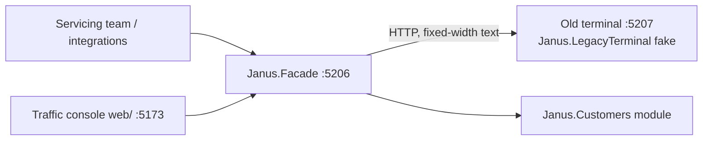

# Architecture

## Style and why
Advisor output (traits: LegacySystems, SeveralBusinessAreas, ExternalPartnerIntegrations, SmallTeam):

### Recommendation: ModularMonolith

Several business areas need clear boundaries, but one deployment and one database keep it cheap to run and easy to hand over.

#### Patterns
- **AdapterPerPartner**: Each outside system gets its own adapter behind an interface, so its quirks stay out of your domain.
- **StranglerFig**: Replace the legacy system one capability at a time behind a facade, never in one big-bang cut-over.

#### Closest reference systems
- Replacing an old system piece by piece (similarity 0.75): Strangler fig: a routing layer sends each feature to the old system or the new modular monolith, until nothing is left on the old one.
- Internet provider (fibre/LTE) (similarity 0.33): Modular monolith, with sagas for weeks-long orders and adapters for the network operators.
- Food delivery (similarity 0.33): Modular monolith, but split live tracking and dispatch into their own service early.

#### Risks to watch
- Modules decay into a big ball of mud unless boundaries are enforced by tests (no cross-module database access).

#### Evolve when
- One module needs to scale or deploy on a different schedule: extract only that module as a service.
- Separate teams own separate modules and block each other's releases.

Record the final choice with write_adr, including what you rejected.

Judgement: Use a strangler fig: a routing layer in front (hand-rolled middleware, see ADR-0003), an adapter around the old system, and a new modular monolith that takes over feature by feature. See `decisions/0001-architecture-style.md`.

## Context

## Modules and boundaries
| Project | Owns | May call |
|---|---|---|
| `Janus.Facade` | capability routing (`/customers`, `/schedules`, `/arrears`), flags per capability (Legacy / Shadow / New), legacy client with timeout + jittered retries + circuit breaker, shadow comparison, `/bridge/status`, `/bridge/flags/{capability}` | Customers module public contract; old terminal over HTTP only |
| `Janus.Customers` | customer details (in-memory store, slice 2 adds persistence) and the anti-corruption layer for legacy `CUS` records | nothing |
| `Janus.LegacyTerminal` | fake of the system we cannot change: `/TERM/CUST`, `/TERM/SCHED`, `/TERM/ARREARS`, `/TERM/FAULT/{NONE,ERROR,SLOW}` | nothing |

Enforced by `tests/Janus.Tests/ArchitectureTests.cs`. Unmigrated capabilities pass through byte-for-byte.

## Cross-cutting
- Errors: ProblemDetails via `Agentic.Blocks.Web` (`code` extension); legacy outage is 503 `bridge.legacy_unavailable` with `Retry-After` when the breaker is open.
- Correlation: `X-Correlation-Id` read/echoed by Blocks.Web and forwarded to the terminal. Responses carry `X-Served-By` and `X-Bridge-Mode`.
- Configuration: `Bridge` section, read through `IOptionsMonitor` per request; appsettings reloads on change; a runtime override provider (Development) wins until cleared.
- Logging: no personal data; HttpClient logs at Warning; shadow logs field paths + hashed fingerprint.
- Auth: none in slice 1 (internal network); Blocks.Auth with an operator role is the next step.
- Dossier: `docs/DESIGN.md`. ADRs: 0001 style, 0002 vendored blocks, 0003 hand-rolled proxy and resilience.
