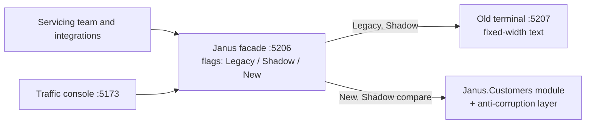

# Janus

> Harbourline Lending is a fictional company. All names, documents and numbers in this repo are invented.

Harbourline's loan servicing runs on an ageing terminal application only two people understand, so every change is slow and risky. Janus, named after the gatekeeper who faces both ways, sits in front of the old terminal and the new modules and moves traffic one capability at a time.

## Design at a glance
**Brief:** move customer details off the old terminal with no downtime, prove old and new agree, and make every move reversible with a flag.

**Architecture:** a strangler fig in front of a modular monolith. `Janus.Facade` is a small reverse proxy (custom middleware over `HttpClient`, no YARP) that reads a flag per capability on every request: **Legacy** forwards to the old terminal, **Shadow** forwards and compares with the new module in the background, **New** serves from the new module. Each response says who served it (`X-Served-By`). The new `Janus.Customers` module owns an anti-corruption layer that turns fixed-width legacy records into clean JSON, and contract tests prove both sides return the same data. The advisor ranked a modular monolith first for a small team with several business areas and a legacy system; microservices lost on operating cost and a rewrite lost on risk. Details: [`docs/DESIGN.md`](docs/DESIGN.md).



## What is in the repo
| Path | What |
|---|---|
| `src/Janus.Facade` | routing middleware, flags (config reload + Development override endpoint), timeouts, retries with jitter, circuit breaker, shadow comparison, `/bridge/status` |
| `src/Janus.Customers` | the first migrated capability: customer directory and the legacy record translator |
| `src/Janus.LegacyTerminal` | a fake of the old system: fixed-width text, upper-case codes, CYYMMDD dates, errors as HTTP 200 |
| `tests/Janus.Tests` | acceptance, contract, translator, resilience, routing and architecture tests |
| `web/` | React traffic console: flip flags, send requests, see which side served each one |

## Run locally
```bash
dotnet run --project src/Janus.LegacyTerminal   # http://localhost:5207
dotnet run --project src/Janus.Facade           # http://localhost:5206
cd web && npm install && npm run dev            # http://localhost:5173
curl -i http://localhost:5206/customers/10042   # X-Served-By: legacy
```
More in `.agentic/runbook.md`.

## How this project is organised
Project knowledge lives in the hidden `.agentic/` folder (start with `.agentic/README.md`). AI agents read `AGENTS.md` first.

Built with the Baton model from the Agentic Engineering Kit: frame → map → decide → sketch → slice loop → pass the baton.
