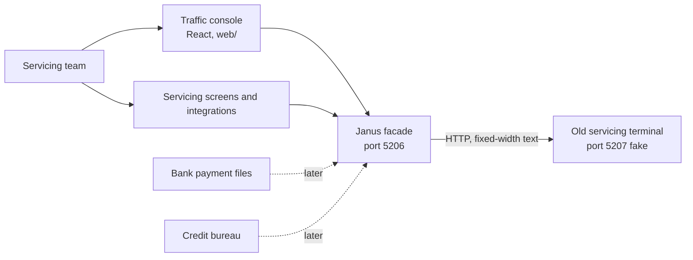
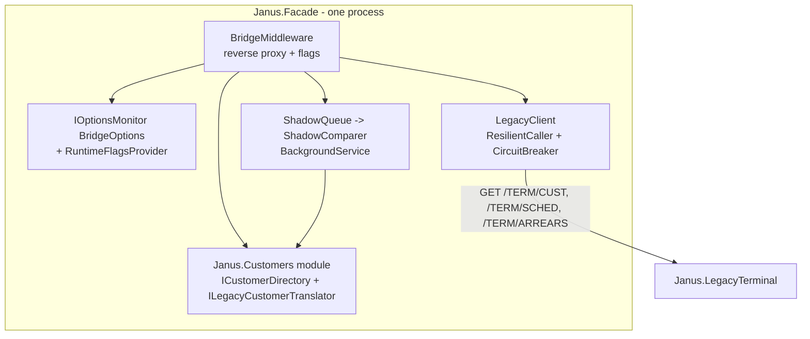
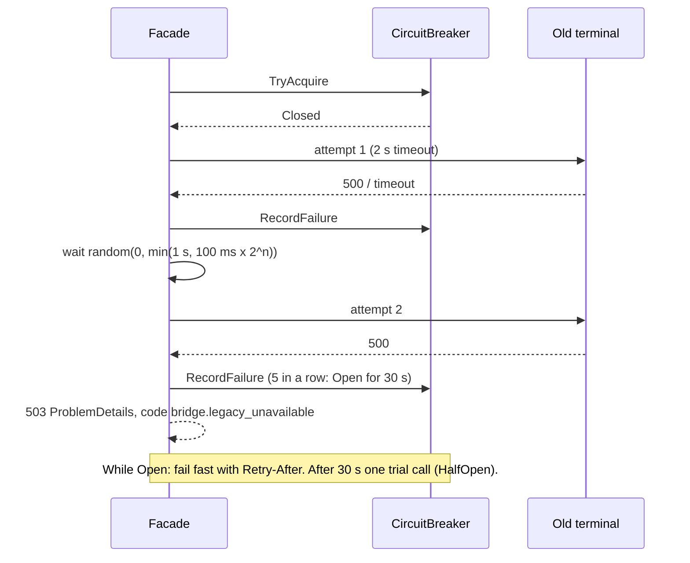
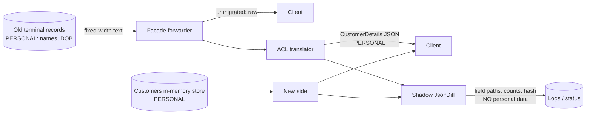

# Janus: design dossier

> Harbourline Lending is a fictional company. Every name, number and record here is invented.

Janus is named after the two-faced gatekeeper: one face looks at the old servicing terminal, the other at the new modules. It is a strangler-fig facade.

## 1. Brief
- **Client:** Harbourline Lending (fictional), a small lender.
- **Problem:** loan servicing runs on an ageing terminal application only two people understand, so every change is slow and risky.
- **Users:** the servicing team (daily, through their usual screens and integrations) and the two developers who make change requests.
- **Outcomes:** move the first capability (customer details) off the old system with no downtime; ship weekly instead of quarterly.
- **Constraint:** the old system keeps running and both sides must agree during migration.

## 2. Requirements
**Functional (slice 1)**
1. `/customers` and `/customers/{number}` are served through the facade; in Legacy mode the old terminal answers via an adapter with identical data.
2. A contract suite proves legacy-via-adapter and the new module return the same results.
3. A flag per capability (Legacy / Shadow / New) moves traffic without a deploy; every routed response carries `X-Served-By`.
4. `/schedules` and `/arrears` pass through untouched until they are migrated.

**Non-functional**
| Concern | Target | Source / assumption |
|---|---|---|
| Added latency at the facade | p95 < 20 ms over the old terminal's own time | proxy is one in-process hop |
| End-to-end p95 | < 300 ms (`quality.md`) | old terminal answers in ~50 ms |
| Availability | 99.9 % / 30 days for the facade; New-mode capabilities stay up when the old terminal is down | |
| Flag change to effect | next request (< 1 s) | `IOptionsMonitor` + reload token |
| Shadow overhead on users | zero added latency | comparison runs after the response, in the background |
| Privacy | no personal data in logs; shadow logs carry field paths, a route template and an 8-char hash only | POPIA / GDPR minimisation |
| Retention | logs 30 days; shadow counters in memory (reset on restart) | slice 1 |

## 3. Capacity estimate
Assumptions: 12 000 active loans, 40 servicing staff, about 150 lookups per person per day, plus batch integrations.
- Interactive: 40 x 150 = 6 000 requests/day, peak hour 25 % = 1 500/h, about **0.5 req/s**; design for 10 req/s.
- Integrations (bank files, bureau checks) add bursts of maybe **50 req/s** for minutes at night.
- Customer record about 200 bytes JSON; 12 000 customers = **2.4 MB**. Storage is irrelevant; correctness is the whole game.
- Shadow doubles reads on the new side only (in-process, microseconds).
- One small instance of the facade is enough by two orders of magnitude; the old terminal is the bottleneck (its own limit, unknown, assume 20 req/s), which is why retries are capped and jittered and the breaker exists.

## 4. Options considered
Output of `arch-advisor compare LegacySystems SeveralBusinessAreas ExternalPartnerIntegrations SmallTeam`:

| Option | Fit | Complexity (1-5) | Main reason |
|---|---|---|---|
| Modular monolith | Recommended | 3 | Matches the advisor's recommended style (ModularMonolith). |
| Modular monolith + CQRS read models | Good alternative | 3 | Same family as the recommendation (ModularMonolith); a valid variant if its trade-offs suit the team. |
| Serverless functions + queues | Possible | 3 | Small team: low enough operational load to run comfortably. |
| Static site + serverless function | Poor fit | 1 | The product has real server-side behaviour and data; a static site can't hold it. |
| Layered monolith | Poor fit | 1 | Several business areas would tangle without module boundaries. |
| Vertical slice monolith | Poor fit | 2 | Several business areas would tangle without module boundaries. |
| Clean Architecture monolith | Poor fit | 2 | Several business areas would tangle without module boundaries. |
| Event-sourced core with CQRS | Poor fit | 4 | Event sourcing's cost isn't repaid without audit, money or replay needs. |
| Microservices (request/response) | Poor fit | 5 | A small team can't run a distributed system well (deployments, tracing, on-call). |
| Event-driven microservices | Poor fit | 5 | A small team can't run a distributed system well (deployments, tracing, on-call). |

- **Strangler fig in front of a modular monolith (chosen).** "Legacy: modules map well onto capabilities moved one at a time." Each capability (customers, schedules, arrears) becomes one module; the facade decides per capability who answers.
- **Big-bang rewrite (rejected, ADR-0001).** Months without value and one risky cut-over, with two people holding all the knowledge.
- **Wrap only (rejected).** An API over the terminal hides it but keeps the risk forever.
- **CQRS read models.** Reasonable later for reporting on arrears; not needed for slice 1.
- **Microservices / serverless.** Two engineers cannot run a distributed system; serverless also fights the long-running old-system connection.
- **Routing layer: YARP vs hand-rolled.** ADR-0001 named YARP; ADR-0003 records the hand-rolled middleware (three prefixes, one upstream, no package feed). YARP remains the swap-in when routes multiply.
- **Global scale:** not a goal (one lender, one country). If it ever were, the facade is stateless and scales horizontally; the old terminal would not, so the answer is "finish the migration", not "scale the facade".
- **Evolution trigger (ADR-0001):** extract a module as a service only when it needs a different scale or release schedule, or separate teams block each other.

## 5. Architecture
**C4 context**

**C4 container**

| Project | Owns | Public contract | May call |
|---|---|---|---|
| `Janus.Facade` | routing, flags, resilience, shadow comparison, `/bridge/*` | `/customers`, `/schedules`, `/arrears`, `/bridge/status`, `/bridge/flags/{capability}`, health | Customers module (public types only), old terminal over HTTP only |
| `Janus.Customers` | customer details, the anti-corruption layer for legacy customer records | `CustomerDetails`, `ICustomerDirectory`, `ILegacyCustomerTranslator`, `CustomersModule` | nothing (architecture tests forbid references to facade or terminal) |
| `Janus.LegacyTerminal` | a stand-in for the system we cannot change | `/TERM/*` fixed-width text | nothing |

## 6. Communication flows
**Slice 1, Legacy and Shadow mode** (sync to the old terminal, async comparison)
```mermaid
sequenceDiagram
  participant C as Client
  participant F as Facade
  participant L as Old terminal
  participant A as ACL (Customers)
  participant Q as ShadowQueue
  participant N as Customers directory
  C->>F: GET /customers/10042
  F->>F: flag customers = Shadow
  F->>L: GET /TERM/CUST/10042 (timeout, retry, breaker)
  L-->>F: 200 "CUS 00010042 CALLOWAY ... 0850312 AC RT ..."
  F->>A: TranslateOne(body)
  A-->>F: CustomerDetails
  F-->>C: 200 JSON, X-Served-By: legacy, X-Bridge-Mode: Shadow
  F--)Q: enqueue (after response is written)
  Q->>N: FindAsync("/10042")
  N-->>Q: CustomerDetails
  Q->>Q: JsonDiff paths; count match/mismatch; log paths only
```
**Riskiest flow: old terminal failing**

Reads are idempotent, so no Idempotency-Key or outbox is needed in slice 1. Non-GET requests are forwarded once (never retried); write capabilities will add Idempotency-Key when they move.

## 7. Data flow

Money appears only in schedules and arrears (11 digits, 2 implied decimals), which pass through untouched in slice 1; when they move, they become `Money` (decimal) in their module.

## 8. Data model
```mermaid
erDiagram
  CUSTOMER ||--o{ LOAN : holds
  LOAN ||--o{ INSTALMENT : "schedule of"
  LOAN ||--o| ARREARS : "may be in"
  CUSTOMER { string customerNumber PK; string givenName; string familyName; date dateOfBirth; string status; string segment; date customerSince; string branch }
  INSTALMENT { string loanNumber; int number; date due; decimal amount; string status }
  ARREARS { string loanNumber; string customerNumber; int daysPastDue; decimal amount; string bucket }
```
| Entity | Owner now | Owner after migration | Consistency |
|---|---|---|---|
| Customer | old terminal (source of truth) | `Janus.Customers` | Shadow: eventual, checked per request; after cut-over: strong in the module |
| Instalment | old terminal | Schedules module (slice 3+) | strong in the terminal |
| Arrears | old terminal | Arrears module | strong in the terminal |

Legacy-to-modern mapping (the ACL): `CUSTNO 00010042` to `"10042"`; upper-case names to title case; `CYYMMDD` (C 0 = 19xx, 1 = 20xx) to ISO dates; `AC/DO/CL` to Active/Dormant/Closed; `RT/SM` to Retail/SmallBusiness; `ERR 0404` with HTTP 200 to 404 `customers.not_found`; `ERR 0400` to 400 `customers.invalid_number`. Unknown codes and impossible dates are rejected (500 `customers.legacy_unreadable`), never guessed.

### Migration sequence per capability
Every capability follows the same five steps; only customers has reached step 3 in slice 1.

| Step | Customers (slice 1) | Schedules (next) | Arrears (after) |
|---|---|---|---|
| 0. Behind the facade, Legacy, pass-through | done | done | done |
| 1. Module + ACL + contract tests green in CI | done | ACL for `SCH` lines, `Money` | ACL for `ARR` lines, buckets |
| 2. Backfill the module from the nightly export, then dual-run | slice 2 (persistence) | | |
| 3. Shadow until 0 mismatches over 7 days and >= 1 000 comparisons | ready (counts in `/bridge/status`) | | |
| 4. New, legacy still running and kept in sync for 30 days | flag flip | | |
| 5. Retire the legacy screen and remove the forwarding route | | | |

### Rollback plan
- **How:** set `Bridge:Capabilities:<capability>:Mode` back to `Legacy` (edit appsettings and let it reload, or `PUT /bridge/flags/<capability>` in Development). The next request is served by the old terminal. No deploy, no data migration.
- **When:** any contract test red, any shadow mismatch after step 3, New-side error rate above 0.5 % for 5 minutes, or a servicing-team report of wrong data.
- **Why it is safe:** the old terminal keeps running and stays the source of truth until step 5. During step 4 writes are not yet moved (slice 1 is read-only), so rolling back loses nothing.
- **Rehearsed by:** `Runtime_flag_switch_moves_traffic_to_new_and_back` and `Configuration_reload_moves_traffic_without_a_restart`.

## 9. Scaling path
1. **The old terminal saturates first.** Cap retries (2), jitter them, and let the breaker shed load. Next: a short read cache (30 s) for list endpoints in the facade.
2. **Shadow queue fills** under bursts: it drops oldest work by design (bounded 512); add sampling (compare 1 in N) if counts stall.
3. **Facade CPU** (not expected below 1 000 req/s): run two instances behind a load balancer; flags come from shared config so both flip together.
4. **Many routes or protocols:** swap the middleware for YARP (ADR-0003).
5. **A module needs its own release cadence:** extract it as a service; the facade already treats "new" as a pluggable side.

## 10. Failure modes
| Failure | Effect | Mitigation |
|---|---|---|
| Old terminal down or slow | Legacy-mode requests fail | 2 s timeout, 2 retries with jitter, breaker opens after 5 failures for 30 s; 503 ProblemDetails with Retry-After; ready check Degraded but still 200 so New-mode capabilities keep serving |
| Old terminal returns an unknown code or bad date | wrong data risk | ACL rejects it (500 `customers.legacy_unreadable`), never guesses |
| Old and new disagree | users could see different data after the flip | contract tests in CI; Shadow counts and field paths; flip only on zero mismatches |
| Flag misconfigured (New on an unmigrated capability) | 404s | the facade ignores it and serves Legacy; the flag endpoint returns 400 `bridge.not_migrated` |
| Duplicate request | none for reads | writes are never retried; Idempotency-Key when write capabilities move |
| Shadow comparer throws | none for users | caught and logged (type only); request already answered |
| Name casing edge cases ("MCALLISTER", "VAN DER BERG") | Shadow mismatch on `familyName` | known ACL limit; add a name-exception table before flipping, mismatches show which field |
| Region outage | facade and terminal down together | same as today; out of scope until the terminal is retired |
| Hot key | not plausible at this volume | read cache if ever needed |

## 11. Security and privacy
- **AuthN/AuthZ:** slice 1 runs inside Harbourline's network behind its existing gateway; the facade forwards only an allow-list of headers (correlation id). Next: `Agentic.Blocks.Auth` bearer tokens with a `servicing` role, and an `operator` role for flag changes.
- **Flag endpoint:** off unless `Bridge:AllowRuntimeFlagChanges` is true (only in `appsettings.Development.json`); production flips through configuration, which is change-controlled.
- **Personal data (POPIA / GDPR):** customer names and dates of birth are personal. They never appear in logs: HttpClient request logging is set to Warning (URLs contain customer numbers), shadow logs carry JSON paths, a route template and an 8-character SHA-256 fingerprint. A test proves the mismatch log contains no name, number or date.
- **Secrets:** none in slice 1. Future credentials (terminal service account) come from environment or a vault; `.env.example` documents keys.
- **Threats per flow:** path traversal into the terminal (only the three prefixes are forwarded; the remainder is appended to a fixed prefix on a fixed host); request smuggling (Kestrel parses; bodies are buffered, not streamed); log injection (structured logging, no raw values).

## 12. Observability
| SLI | SLO |
|---|---|
| Facade success rate (non-5xx) | 99.9 % / 30 days |
| p95 latency, Legacy mode | < 300 ms |
| p95 latency, New mode | < 50 ms |
| Shadow mismatch rate per capability | 0 before a flip |
| Breaker open time | < 5 min/day |

Signals: `X-Served-By` and `X-Bridge-Mode` on every routed response; `X-Correlation-Id` propagated to the terminal; `/bridge/status` (flags, breaker, shadow counts); `/health/live`, `/health/ready`. **The alert that wakes someone:** breaker open for more than 5 minutes during business hours, or any shadow mismatch on a capability that is in New mode.

## 13. Testing strategy
| Layer | What | Where |
|---|---|---|
| Rules | ACL translation (dates, codes, errors, trailers), back-off maths, breaker state machine, retry/timeout behaviour | `TranslatorTests`, `ResilienceTests` |
| Contracts | 10 scenarios through two facades (Legacy vs New) must match status and body; every legacy record translates to the module's record | `ContractTests` |
| Seams / journeys | real Kestrel hosts for facade and fake terminal | `AcceptanceTests` |
| Boundaries | module never references facade or terminal; facade never references the terminal; module exports only its contract | `ArchitectureTests` |
| UI logic | served-by parsing, request log summary, ready-to-flip rule | `web/src/bridge.test.ts` |

| Acceptance criterion | Tests |
|---|---|
| Legacy mode serves via adapter with identical data | `Customers_in_legacy_mode_are_served_by_the_legacy_adapter_with_identical_data`, `Customer_list_in_legacy_mode_has_every_seeded_customer`, `Legacy_not_found_quirk_becomes_a_404_problem` |
| Old and new return the same results | `Legacy_via_adapter_and_new_module_agree_over_http` (10 cases), `Every_legacy_record_translates_to_the_new_modules_record` |
| Flag switch moves traffic without a deploy | `Runtime_flag_switch_moves_traffic_to_new_and_back`, `Configuration_reload_moves_traffic_without_a_restart`, `Shadow_mode_serves_legacy_and_records_a_match` |

## 14. Interview questions
1. **Why a strangler fig and not a rewrite?** Two people understand the old system; a rewrite bets everything on one cut-over. The fig moves one capability at a time, each reversible with a flag.
2. **How do you know old and new agree?** Twice: contract tests in CI run identical scenarios against legacy-via-adapter and new; Shadow mode compares real traffic in the background and counts mismatches per field.
3. **Why does the new module own the anti-corruption layer?** The legacy shape must stop at the boundary of the model that replaces it. The facade knows routes, not record layouts.
4. **What happens if the terminal hangs?** Each attempt has a 2 s timeout; two jittered retries; five consecutive failures open the breaker for 30 s; callers get a 503 ProblemDetails with Retry-After instead of piling up threads.
5. **Why full jitter?** Retries from many clients would otherwise arrive in waves and keep a struggling terminal down.
6. **How do you flip without a deploy?** Flags live in configuration read through `IOptionsMonitor` on every request; a file change or a runtime override raises a reload token, and the next request uses the new mode.
7. **Shadow doubles the work. Is that a problem?** The comparison runs after the response, in a bounded queue that drops oldest work, and the new side is in-process. Users see no extra latency.
8. **How do you avoid leaking personal data while comparing?** Compare in memory, log only JSON paths, a route template and a short hash. A test asserts no name, number or date reaches the logs.
9. **What would you change at 100x traffic?** The terminal breaks first, not the facade: add a short read cache and sampling for Shadow, then finish moving reads. The facade is stateless and scales out.
10. **How do you roll back?** Set the mode back to Legacy. The terminal kept running and remains the source of truth until the capability is retired.
